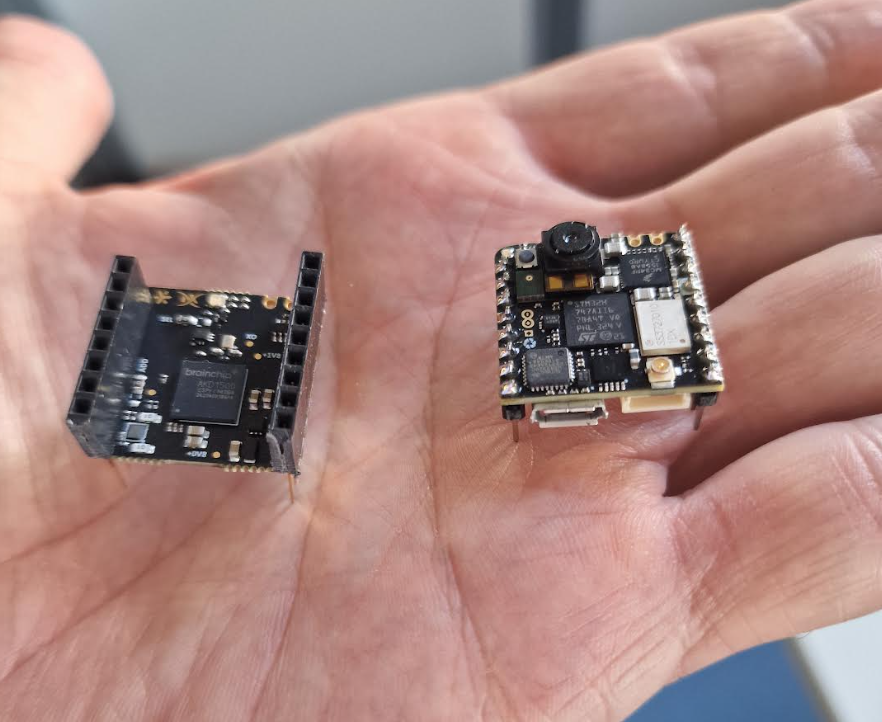
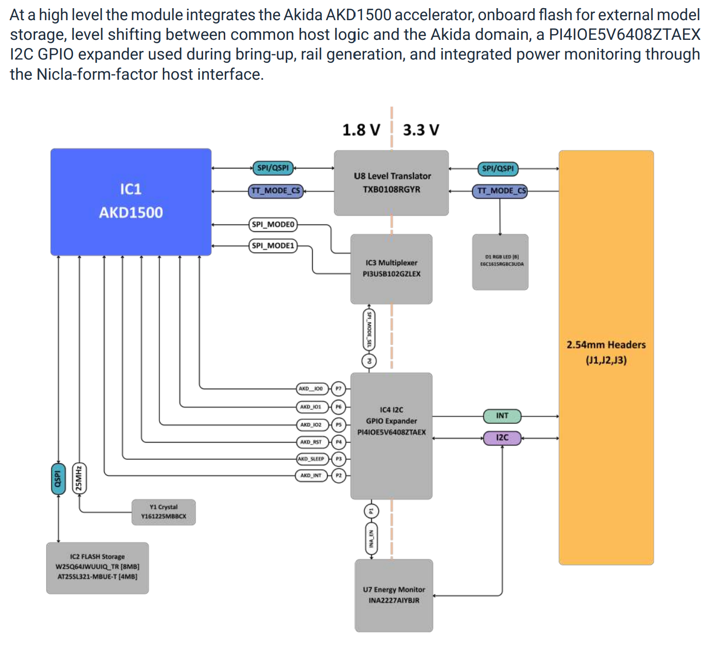

# BrainBoard1500

> **This is BrainChip's fork of
> [Neuromorphyx/BrainBoard1500](https://github.com/Neuromorphyx/BrainBoard1500).**
> The library itself is Neuromorphyx's work: BrainBoard1500 Arduino Library by
> Neuromorphyx / NEX NOVUS d.o.o. BrainChip adds its own demos under
> `examples/BrainChip/`, kept apart from the upstream examples.

Arduino library for the **BrainBoard1500 (BB15) rev 2** – a BrainChip AKD1500
neuromorphic accelerator module – driven by an **Arduino Nicla Vision**.



> **Disclaimer:** This library was created for the BrainBoard1500, which uses
> the AKD1500 event-based hardware accelerator. BrainChip is not responsible
> for this library.

This library is a clean-room implementation written from publicly available
information and measurements on the board (see [Sources](#sources)). It runs Akida models with the
**Akida Engine 2.19.3** and ships the Akida 1 models of the
[BrainChip Dev Hub](https://github.com/Brainchip-Inc/brainchip_devhub) as
ready-to-run examples, including two models that learn on the chip.

| Feature | |
|---|---|
| Akida runtime | Akida Engine 2.19.3 (from the `akida` 2.19.3 Python package), ported to the Arduino mbed core |
| Host link | SPI at 25 MHz; link test by reading the AKD1500 manufacturer id (0xBC = BrainChip) |
| Model storage | 4 MiB flash split into four 1 MiB slots, or push over SPI (slot 0) |
| Fast flash boot | flash probe skipped, only the SPI master XIP profile is written |
| Power | INA2227: power of the 0.8 V core rail in mW in every example |
| Output | everything on the serial port **and** a 128x64 SSD1306 OLED (I2C 0x3C) |
| On-chip learning | learn your face (camera) and your voice (microphone) on the AKD1500 |

> **Validation status:** all examples compile for `arduino:mbed_nicla:nicla_vision`
> and all examples (01–11) have run on a BB15 rev 2 with a Nicla Vision.
> Measured on the board: SPI block transfers (31.0 → 16.0 ms per VWW inference, scores
> bit-identical), camera frame rates of 03, 05, 07 and 10 (see
> [Camera frame rate](#camera-frame-rate)), `09_MaxDutyCycle` with 776
> inferences/s at about 216 mW on the 0.8 V rail, and the INA2227 wiring. The
> preprocessing (MFCC, speaker code, image scaling) and every exported model were
> also validated on the PC against the Dev Hub pipelines and the akida Python
> simulation.

## Hardware


* Arduino Nicla Vision stacked on a BB15 rev 2 (Renesas AT25SL321 flash).
  BB15 rev 1 (Winbond W25Q64JW, read out on a rev-1 board) is
  obsolete but selectable in `BoardConfig`.
* Optional: SSD1306 128x64 monochrome OLED on the shared I2C bus at 0x3C.

| BB15 pad | Signal | Nicla Vision | Arduino pin |
|---|---|---|---|
| A1 | INT (expander interrupt) | J1-1 D0 | 0 |
| A3 | AKIDA_CS | J1-3 SS | 7 |
| A4 / A5 / A6 | MOSI / MISO / SCK | J1-4 / 5 / 6 | SPI |
| A8 | RESET = power-sequencer enable | J1-8 A0 | 15 |
| B5 | TT_MODE_CS (flash bridge chip select) | J2-5 D3 | 3 |
| B1 / B2 | SDA / SCL | J2-1 / 2 | Wire |

I2C devices: PI4IOE5V6408 expander 0x43 (P0 SPI_MODE_SEL, P1 INA_EN,
P2 AKD_INT, P3 AKD_SLEEP, P4 AKD_RST), INA2227 0x40 (channel 1 = 0.8 V rail,
channel 2 = 1.8 V rail, 10 mΩ shunts), OLED 0x3C.

## Installation

1. Copy this folder to your Arduino `libraries` folder (or install the ZIP via
   *Sketch → Include Library → Add .ZIP Library*).
2. Install **Adafruit GFX Library** and **Adafruit SSD1306** with the Library
   Manager.
3. Install the **Arduino Mbed OS Nicla Boards** core and select *Nicla Vision*.

## Quick start

| Step | Example | What it does |
|---|---|---|
| 1 | `01_SpiLinkTest` | manufacturer id over SPI, flash probe, slot table, 64 KiB SRAM read/write test with throughput, both rail powers |
| 2 | `02_ModelFlasher` | writes the models into the four flash slots, verifies them and boots every slot with a self test |
| 3 | `03_PersonDetection` | Dev Hub VWW person detection, full camera field of view |
| 4 | `04_KeywordSpotting` | Dev Hub speech_commands, 10 keywords from the PDM microphone |
| 5 | `05_ImageNetClassification` | Dev Hub AkidaNet, 1000 ImageNet classes |
| 6 | `06_EcgArrhythmia` | Dev Hub ECG beat classification on MIT-BIH test beats |
| 7 | `07_FaceLearning` | learns your face on the chip: green LED = you, blue LED = someone else |
| 8 | `08_VoiceLearning` | learns your voice on the chip: green LED = you, blue LED = someone else |
| 9 | `09_MaxDutyCycle` | keeps the AKD1500 near 100 % busy: input once in AKD1500 SRAM, 15-job hardware pipeline, no per-inference transfers |
| 10 | `10_ImageNetSubset` | your own 100 of the 1000 ImageNet classes (tools/imagenet_subset.txt), top 3 with probabilities |
| 11 | `11_PowerModes` | endless loop, 10 s each: power at 100 % duty, 10 % duty, idle, sleep, off (0 mW); wake time after off |

Run `02_ModelFlasher` once before the examples that boot from flash. All
examples print to the serial monitor at 115200 baud and to the OLED.

## Model storage: flash slots

```
  1 = BB15 external flash, slot 1 at offset 0x000000
  2 = BB15 external flash, slot 2 at offset 0x100000  (1 MiB)
  3 = BB15 external flash, slot 3 at offset 0x200000  (2 MiB)
  4 = BB15 external flash, slot 4 at offset 0x300000  (3 MiB)
  0 = do not use the flash, push the model into the AKD1500 via SPI
```

Every slot holds a 4 KiB header (name, sizes, CRC-32 of program info and
program data), the program data at +0x1000, and a 64 KiB user area at +0xF0000
(used for learned weights). Each example selects its source with one line:

```cpp
constexpr uint8_t kModelSlot = 1;  // 0 = SPI push, 1..4 = flash slot
```

The serialized Akida program is *program info* (stays on the host) followed by
*program data*. From a flash slot only the program info is sent over SPI; the
AKD1500 reads the program data itself through its SPI master at 0x8000_0000.
Sketches that boot from flash therefore do not link the program data.

**Skipping the flash-profile probe.** Probing the flash (S2M bridge on and off
twice, reset preamble, JEDEC id, quad-enable bit) takes about one second.
`BoardConfig::assumeFlashReady = true` (the default) skips it and only writes
the SPI master XIP configuration for the selected chip. `02_ModelFlasher` and
`01_SpiLinkTest` run the full probe once and set the non-volatile quad-enable
bit, which is all the fast path needs.

| Default | Slot | Model | Program | Notes |
|---|---|---|---|---|
| `03_PersonDetection` | 1 | vww | 210 KB | 96x96x3 |
| `04_KeywordSpotting` | 2 | kws | 70 KB | 49x10 MFCC |
| `05_ImageNetClassification` | 3 | imagenet | 442 KB | 160x160x3; its FNP2 classifier weights stay in flash |
| `07_FaceLearning` | 4 | face_learn | 211 KB | learned weights in the slot 4 user area |
| `06_EcgArrhythmia` | 0 | ecg | 64 KB | pushed over SPI |
| `08_VoiceLearning` | 0 | voice_learn | 2 KB | pushed over SPI, weights in the slot 2 user area |

## Preprocessing on the Nicla Vision

* **Camera** (GC2145, `CAMERA_R320x240`, `CAMERA_RGB565`, the largest RGB565
  frame that fits the Nicla Vision RAM): the image is rotated by 180° so the
  board is held with the micro-USB connector pointing down. Pixels are
  resampled with an area average.
  * Person detection scales the **complete frame** to 96x96, like the Dev Hub
    training (`flow_from_directory(target_size=(96, 96))`), instead of cutting
    out the centre.
  * ImageNet uses the Dev Hub geometry: shorter side to 183 px, centre
    160x160 (the central 210x210 of a 320x240 frame).
  * Face learning uses the central 240x240 square.
* **Audio** (PDM microphone, 16 kHz, gain 12): DC removal first (the PDM
  microphone has an offset of a few hundred counts), then
  * keywords: the exact Dev Hub MFCC (peak normalisation, 30 ms Hann, 20 ms hop,
    512 FFT, 40 mel bands 20–4000 Hz, 10 coefficients, uint8 range
    −51.43…14.23), decided over a sliding window of four 200 ms steps;
  * voice learning: a 304-bit speaker code (spectral envelope of the voiced
    frames + pitch), see below.

The C++ front ends are bit-exact with the NumPy references in `tools/`
(`cbb15_mfcc.py`, `cbb15_speaker.py`).

## On-chip learning

Akida learns in a final FullyConnected layer with binary inputs.

* **Face** (`face_learn`): the Dev Hub VWW AkidaNet is reused as feature
  extractor; its last feature layer is turned into 256 binary features
  (per-channel thresholds calibrated on the Dev Hub sample images) and a
  learning layer with 3 classes × 10 neurons is added
  (me / other person / background).
* **Voice** (`voice_learn`): a keyword network is trained to ignore who is
  speaking (77 % speaker accuracy on two synthetic voices), so the voice
  example uses a speaker code instead (91–98 %): mean level of 32 mel bands
  (60–7600 Hz) over the voiced frames relative to their own mean, plus the
  median pitch, encoded as 304 bits. The AKD1500 learns on that code
  (2 classes × 10 neurons).

Learning is switched on only for a labelled learning step; plain inference
never changes the weights. Every step stores one example in one neuron, so
teach each class several times. Learned weights can be saved to and restored
from the user area of a flash slot (command `s` / `l`).

## Power measurement

`cbb15::showPower()` / `corePowerMilliwatts()` read the INA2227 channel 1
(0.8 V AKD1500 core). The power is computed from the raw shunt voltage
(625 nV/LSB, ±20.48 mV range) and bus voltage (1.6 mV/LSB) with 16 averages,
so it does not depend on the calibration register. `01_SpiLinkTest` also shows
the 1.8 V rail.

## Inference time and duty cycle

Every `InferenceResult` carries two times:

* `computeUs` – the pure inference time, measured by the AKD1500 itself: its
  input DMA buffer timer counts core clock cycles (400 MHz) while the job is
  processed. The counter is restarted for every job.
* `latencyUs` – enqueue until the output is fetched, i.e. including the SPI
  transfer of the input (27,648 bytes for a 96x96x3 image) and of the output.

The duty cycle has one definition in all examples: the share of the elapsed
time in which the AKD1500 has work in its pipeline,
`duty = 1 - idle / elapsed`, never above 100 %. Sensor capture, preprocessing
and the SPI transfers count as idle. Each sketch repeats this in its header.

* With one job in flight at a time (03, 04, 05, 06, 07, 10) the busy time is
  the sum of the `computeUs` values. `cbb15::DutyCycle` adds them up over 2 s
  windows and shows the result as `AKD duty x.x%`. 08 runs the AKD1500 only
  once per utterance and shows the inference time only.
* `09_MaxDutyCycle` keeps up to 15 jobs in the pipeline. They overlap, one in
  the first layers and the next ones further down the mesh, so
  "inferences/s × `computeUs`" counts the same time several times and comes
  out far above 100 %. The idle time is measured directly instead: a loop pass
  that finds every job finished books the time since the previous pass as
  idle. The example also shows the overlap (inferences/s × single-job time).

`09_MaxDutyCycle` shows how close to 100 % the AKD1500 can be driven: the
input image is written into the AKD1500 SRAM once and enqueued by address
(`Akida::startStream()` / `streamStep()`), so no image data crosses the SPI bus
per inference, and up to 15 jobs wait in the hardware pipeline while the host
fetches results or captures a new frame. The LED is green while the newest job
sees a person and off otherwise.

## SPI transfer speed

mbed's `SPIClass::transfer()` sends one byte per call and stops the clock
between bytes, so a 27,648-byte input took about 25 ms at 25 MHz. BrainBoard1500
drives the Nicla Vision SPI peripheral with one block transfer per burst
instead (`src/cbb15/cbb15_spi_fast.*`), for the AKD1500 and for the flash
bridge alike. Measured with VWW on BB15 rev 2:

| SPI path | per inference, incl. input transfer |
|---|---|
| mbed byte path | 31.0 ms |
| block transfer (default) | 16.0 ms |

The scores are bit-identical. The boot log shows the active path, e.g.
`SPI SPI4 block 25 MHz`. To fall back to the mbed path, build with
`-DCBB15_SPI_FAST=0` (for example
`--build-property "compiler.cpp.extra_flags=-DCBB15_SPI_FAST=0"` with
arduino-cli; a `#define` in the sketch does not reach the library).

## Camera frame rate

The GC2145 delivers a 320x240 RGB565 frame every **46.4 ms** (21.6 frames/s).
Reading it out takes about 33 ms, so there is a gap of about 13 ms between two
frames. `GC2145::setFrameRate()` is empty in the Arduino core: the frame rate
argument of `Camera::begin()` has no effect.

`Camera::grabFrame()` waits for the next frame start and then reads a whole
frame. Any processing between two calls that takes longer than the 13 ms gap
misses a frame, so a loop with 8 ms preprocessing and 16 ms inference got only
every second frame. The camera examples (03, 05, 07, 09, 10) therefore use
`cbb15::CameraStream` (`src/cbb15/cbb15_camera_stream.*`): two frame buffers,
and the next frame is read out while the sketch processes the current one.

```cpp
alignas(32) uint8_t frames[2][320 * 240 * 2];   // AXI SRAM, reachable by DMA
cbb15::CameraStream stream;

cam.begin(CAMERA_R320x240, CAMERA_RGB565, 15);   // pins, clocks, DCMI setup
stream.begin(frames[0], frames[1], sizeof(frames[0]));
const uint8_t* pixels = stream.next(3000);       // finished frame, next one armed
```

`next()` returns the finished frame and immediately starts the next capture
into the other buffer. After a long pause the waiting frame is as old as the
pause; `skipFinished()` drops it (07 before every learned view, 09 before
every input refresh). `ready()` tells without blocking whether a frame is
complete, so 09 keeps its AKD1500 pipeline fed while it waits.

The OLED was the second brake. On mbed every `Wire.setClock()` call costs
**11.6 ms**, and Adafruit_SSD1306 switches the clock twice per transfer, so a
full `display()` blocks for about 50 ms. With `Console::setPagedDisplay(true)`
`publish()` draws the frame into RAM and sends 64 bytes per call at the bus
clock (about 6 ms); a complete update takes 16 loop passes.

Measured on BB15 rev 2 + Nicla Vision (1.1.0 SPI block transfers in both
columns):

| Example | before | with CameraStream | limited by |
|---|---|---|---|
| 03 person detection | 9 frames/s | **21.6 frames/s** | sensor |
| 07 face learning | – | **21.6 frames/s** | sensor |
| 10 ImageNet subset | ~10 frames/s | **16.3 frames/s** | inference (40.8 ms incl. transfer) |
| 05 ImageNet (1000 classes) | – | **11.9 frames/s** | inference (66 ms incl. transfer) |

The examples show the frame rate and the time spent waiting for the frame
(`21.6 fps wait 13 ms`: 13 ms to spare per frame). The two frame buffers take
307 KB of static RAM; 05 and 10 then use 84 % of the RAM and run normally.
Do not mix `CameraStream` with `Camera::grabFrame()`.

## Library structure

| File | Content |
|---|---|
| `src/BrainBoard1500.h` | umbrella header |
| `src/cbb15/cbb15_board.*` | bring-up, power, reset, sleep, SPI link test, flash slots |
| `src/cbb15/cbb15_spi_link.*`, `cbb15_spi_fast.*` | SPI transport for the engine and the flash bridge, block transfers |
| `src/cbb15/cbb15_akida.*` | model loading, inference, learning |
| `src/cbb15/cbb15_flash.*` | S2M flash bridge, flash profiles, XIP runtime profile |
| `src/cbb15/cbb15_expander.*`, `cbb15_power.*` | PI4IOE5V6408, INA2227 |
| `src/cbb15/cbb15_console.*` | Serial + OLED output, stepwise OLED updates |
| `src/cbb15/cbb15_camera_stream.*` | double-buffered camera capture (DCMI + DMA) |
| `src/cbb15/cbb15_image.*`, `cbb15_mfcc.*`, `cbb15_speaker.*` | preprocessing |
| `src/cbb15_models/*.h` | generated, header-only models and sample inputs (master copies) |
| `examples/<sketch>/*.h` | local model copies next to each example sketch, kept in sync by `tools/sync_examples.py` |
| `src/akida`, `src/akida_engine`, `src/engine`, `src/infra`, `src/akd1500` | Akida Engine 2.19.3 (Apache 2.0), see [PATCHES.md](PATCHES.md) |
| `src/flatbuffers` | Google FlatBuffers 2.0.8 headers (Apache 2.0) |
| `tools/` | model export, learning-model builder, sample generator, engine patcher |

## Not included

* **PlantVillage** (Dev Hub): two passes and 1.15 MB of program – larger than
  a 1 MiB slot, and over SPI it leaves no room in the 1 MiB AKD1500 SRAM for
  its 224x224x3 input.
* **UORED-VAFCLS** (Dev Hub): needs a vibration dataset/sensor the Nicla Vision
  does not provide.

## Sources

Public information was used, with one exception (see below):

* BB15 datasheet rev 2.1 (linked on neuromorphyx.com/brainboard1500)
* AKD1500 datasheet V1.4 (public PDF on shop.brainchipinc.com): memory map,
  SPI slave protocol, S2M pin mux, system configuration registers
* PI4IOE5V6408 datasheet (Diodes DS40583)
* <https://neuromorphyx.com/brainboard1500>
* <https://github.com/Neuromorphyx/BrainBoard1500_arduino_library>
* TI INA2227 datasheet (SBOSAL5); the flash chips are driven with standard
  SPI NOR commands, their JEDEC ids and quad-enable bits as published in the
  BB15 datasheet and the public BB15 library
* <https://doc.brainchipinc.com/> and the `akida` / `akida_models` packages on PyPI
* <https://github.com/Brainchip-Inc/brainchip_devhub> (models, preprocessing,
  sample images), the BrainChip *imagenet_like* sample pack, MIT-BIH
  (PhysioNet) for the ECG beats
* <https://docs.arduino.cc/tutorials/nicla-vision/user-manual/> and the Nicla
  Vision datasheet

**Measured on the board:** some values were measured on a
BB15 rev 2: the INA2227 I2C address 0x40, its channel assignment (channel 1 =
0.8 V rail, channel 2 = 1.8 V rail), the 10 mOhm shunt resistors, and the
150 ms the rails need after A8 goes high (`cbb15_config.h`, `cbb15_power.h`),
and the Winbond W25Q64JW flash (JEDEC EF 60 17) on a BB15 rev 1.
The 250 ms guard band around switching the flash bridge is taken from the
public BB15 library.

## License

The BrainBoard1500 Arduino integration library is developed by
NEX NOVUS d.o.o. under the Neuromorphyx brand and released under the
[Apache License 2.0](LICENSE). Commercial use is permitted.

Third-party software, models and data retain their respective licence
terms. See [NOTICE](NOTICE) for attribution and details.

When describing a project that uses this library, please credit:
“BrainBoard1500 Arduino Library by Neuromorphyx / NEX NOVUS d.o.o.”
This public acknowledgement is requested, not an additional licence
condition. Apache 2.0 notice-preservation requirements still apply.

For paid production integration, custom model development, hardware
supply or technical support, contact info@neuromorphyx.com.
